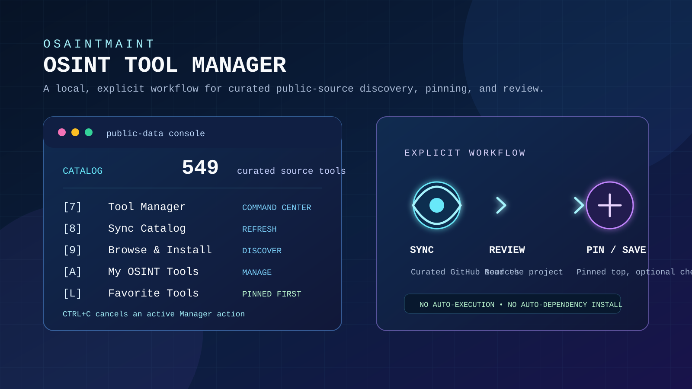

<p align="center">
  
</p>

<h1 align="center">OsaintMaint</h1>

<p align="center">
  <strong>Unhide what's public. Verify what matters.</strong><br>
  A local-first Python workspace for responsible public-data research,<br>
  source review, watchdogs, reports, and OSINT tool management.
</p>

<p align="center">
  <a href="#-quick-start">
    
  </a>
  <a href="LICENSE">
    
  </a>
  <a href="#-open-source--community">
    
  </a>
  <a href="#-responsible-use">
    
  </a>
  <a href="#-windows-launcher">
    
  </a>
</p>

<p align="center">
  <a href="#-quick-start">Quick start</a> ·
  <a href="#-what-you-get">Features</a> ·
  <a href="#-osint-tool-manager">Tool Manager</a> ·
  <a href="#-public-data-workspace">Public data</a> ·
  <a href="#-suggest-a-tool">Suggest a tool</a> ·
  <a href="#-open-source--community">Community</a> ·
  <a href="#-responsible-use">Responsible use</a>
</p>

---

> [!IMPORTANT]
> OsaintMaint is for **lawful, authorized research of public information only**.
> It does not bypass access controls, collect credentials, identify private people,
> or automatically run third-party code. Every result should be verified against
> its original source before it is used.

---

## 🔭 What you get

| Workspace | Built for |
| --- | --- |
| 🧭 **Keyboard dashboard** | A smooth terminal home screen with filters, scrolling, context help, and a responsive eye banner that fits ordinary Command Prompt windows. |
| 👁️ **OSINT Tool Manager** | Sync curated public GitHub indexes, search hundreds of documented source projects, favorite the best ones, and save only tools you explicitly choose. |
| 📡 **Public-data workspace** | Pull, normalize, search, inspect, export, and audit supported public-safety event data in a local SQLite database. |
| 🐕 **Watchdogs and watch rules** | Poll configured sources with bounded requests, record health, deduplicate findings, and evaluate local alert rules. |
| 🧪 **Quality and provenance** | Surface missing fields, preserve original payload context, and distinguish uncertain data from verified facts. |
| 📁 **Site workspace** | Keep a local list of approved public HTTP(S) sources and open them when you need them. |
| 📄 **Portable reports** | Export JSON, CSV, or a self-contained HTML report without requiring a cloud account. |

<p align="center">
  
</p>

<p align="center">
  <sub>Local records, explicit source review, and clear provenance — built for people who want to understand the data they use.</sub>
</p>

---

## ⚡ Quick start

### 🪟 Windows launcher

From a cloned or downloaded project folder, open a terminal and run:

```powershell
.\osaint.bat
```

The launcher:
- Creates a local virtual environment when needed
- Installs OsaintMaint itself (no third-party OSINT projects are touched)
- Applies a high-contrast console theme when supported
- Starts the interactive dashboard

> [!TIP]
> Git is only needed when you explicitly sync the Tool Manager catalog or save
> a selected source checkout. Local JSON ingestion, search, reporting, and most
> dashboard work stay fully local with zero network activity.

### 🐍 Python CLI

OsaintMaint requires **Python 3.11 or newer**.

```powershell
# 1. Create and activate a virtual environment
python -m venv .venv
.\.venv\Scripts\Activate.ps1

# 2. Install the project in editable mode
python -m pip install -e .

# 3. Launch the dashboard
osaint
```

Use a focused command when you don't need the full dashboard:

```powershell
osaint --help
osaint status
osaint tools status
```

---

## 🎮 Dashboard controls

### Navigation

| Control | Action |
| --- | --- |
| Arrow keys or `J` / `K` | Move through the menu |
| `Enter` | Open the selected workspace |
| `/` | Filter menu choices |
| `Backspace` | Edit a filter |
| `Esc` | Clear the filter or cancel the current action |
| `Q` | Leave the dashboard |
| `Ctrl+C` | Cancel a Manager action; press twice quickly inside the Manager to return to the main dashboard |

### OSINT workspace shortcuts

| Key | Workspace |
| --- | --- |
| `[7]` | OSINT Tool Manager |
| `[8]` | Sync OSINT Catalog |
| `[9]` | Browse & Install OSINT |
| `[A]` | My OSINT Tools |
| `[L]` | Favorite OSINT Tools |

---

## 🔧 OSINT Tool Manager

The Tool Manager makes a large public catalog easy to navigate without turning OsaintMaint into a tool-execution platform. It synchronizes documented source projects from [jivoi/awesome-osint](https://github.com/jivoi/awesome-osint) and [osintshifu/awesome-osint-repos](https://github.com/osintshifu/awesome-osint-repos), deduplicates by repository, and stores the catalog locally.

> A fresh catalog currently contains about **549 selectable source projects**; the total changes as upstream indexes are updated.

<p align="center">
  
</p>

| Step | Action |
| --- | --- |
| **1. Sync** | Refresh curated GitHub indexes |
| **2. Search** | Filter by name, category, or description |
| **3. Inspect** | Review the source, provenance, and project page |
| **4. Favorite** | Pin useful projects to the top of every Manager list |
| **5. Save and manage** | Save, open, update, or explicitly remove one source checkout |

### ⭐ Favorites that stay useful

Press `F` while viewing any catalog tool or saved tool to **pin or unpin** it.

- Favorites are stored locally
- Show **first** in browse, search, and saved-tool lists
- Remain pinned even when you remove the local source checkout
- Open the dedicated view with `[L]` from the dashboard, or option `[4]` inside the Tool Manager

### 💻 Manager commands

```powershell
# Sync the catalog from upstream indexes
osaint tools sync

# Search the catalog
osaint tools list --query geolocation

# Inspect a specific tool
osaint tools info --id tool-id-from-the-list

# Manage favorites
osaint tools favorite --id tool-id-from-the-list
osaint tools favorites
osaint tools list --favorites
osaint tools unfavorite --id tool-id-from-the-list

# Save / update / remove a source checkout under managed-tools/
osaint tools install --id tool-id-from-the-list
osaint tools update --id tool-id-from-the-list
osaint tools remove --id tool-id-from-the-list --yes

# Status as JSON
osaint tools status --json
```

> [!NOTE]
> **"Install" means saving a Git source checkout** under `managed-tools/`.
> The Manager never runs setup scripts, installs dependencies, launches selected
> tools, or collects data on your behalf. You decide what to run — after reviewing
> each project's own documentation and terms.

---

## 📡 Public-data workspace

OsaintMaint can ingest trusted local JSON or use the documented
[TuerSS Public Safety API](https://github.com/hacker123as/tuerss-public-safety-api)
contract. Records are normalized into a stable local schema with category,
severity, timestamps, location, provenance, and source URL.

### Supported resource names

`incidents` · `dispatch` · `wanted` · `missing` · `arrests` · `jail` ·
`courts` · `stolen-vehicles` · `registry` · `statistics` · `fire-ems`

A deployed source's availability, billing, or error response is surfaced as a
**source condition** — never mistaken for real event data.

### Workspace commands

```powershell
# Initialize a database and write example configuration
osaint init --config config\example.json

# Ingest a local JSON event payload
osaint ingest --db data\osaint.db --input tests\fixtures\events.json

# Pull live records from a configured public-data source
osaint source-pull --config config\example.json --resource incidents --state IL --city Chicago --limit 25

# Search normalized local events
osaint search --db data\osaint.db --query fire --json

# Add a watch rule
osaint watch add --db data\osaint.db --name "nearby fire" --query fire --category fire_ems --min-severity high

# Run a watchdog once
osaint watchdog run --config config\example.json --resource fire-ems --once

# Export a self-contained HTML report
osaint export --db data\osaint.db --format html --out report.html
```

---

## 🐕 Watchdogs, quality, and audit

OsaintMaint is designed to make **uncertainty visible**.

- **Watch rules** filter by query, category, source, severity, and geographic bounding box; deduplication prevents repeat noise.
- **Watchdogs** use bounded requests, timeouts, rate limits, response-size limits, and persistent run history.
- **Quality scans** flag incomplete locations, timestamps, URLs, and unknown severity.
- **Audit records** preserve the context of key local operations.

```powershell
# List active watch rules
osaint watch list

# Review recent watchdog runs (latest 20)
osaint watchdogs --limit 20

# Run a data quality scan
osaint quality

# Review the local audit trail (latest 20 entries)
osaint audit --limit 20
```

---

## 🌐 Site workspace

Save the public sources you trust for later review. OsaintMaint accepts complete
HTTP(S) URLs and **refuses URLs containing credentials**.

```powershell
osaint sites add --name "Chicago data portal" --url "https://data.cityofchicago.org"
osaint sites list --json
osaint sites open --name "Chicago data portal"
osaint sites remove --name "Chicago data portal"
```

---

## 💡 Suggest a tool

OsaintMaint is open source and the **community helps decide what gets added next**.

If you know a publicly-documented OSINT or public-data research tool that belongs
in the catalog — or if you think a whole new workspace, command, or integration
should exist — open an issue:

👉 **[Open a Tool / Feature Suggestion](.github/ISSUE_TEMPLATE/tool_suggestion.yml)**

> [!TIP]
> Not sure if your idea fits? Check [CONTRIBUTING.md](CONTRIBUTING.md) first —
> it explains what makes a good Tool Manager source and how to propose new
> workspaces or commands.

**What the community is asking for** (tracked via the `suggestion` label):

| Category | Ideas welcome for |
| --- | --- |
| 🔍 **New tool sources** | Publicly-documented repos not yet in the catalog |
| 🗺️ **New data resources** | Additional public-safety or civic-data API shapes |
| 📊 **New export formats** | PDF reports, GeoJSON, Markdown summaries |
| 🧩 **New workspaces** | Domain-specific research panels (court records, property data, etc.) |
| 🤝 **Integrations** | Connections to other local-first research tools |

---

## 🤝 Open source & community

OsaintMaint is made to be **public, inspectable, and easy to improve**.

| File | Purpose |
| --- | --- |
| [LICENSE](LICENSE) | MIT license |
| [CONTRIBUTING.md](CONTRIBUTING.md) | Contribution guide |
| [SECURITY.md](SECURITY.md) | Security reporting guidance |
| [CODE_OF_CONDUCT.md](CODE_OF_CONDUCT.md) | Community expectations |
| [SUPPORT.md](SUPPORT.md) | Help and issue-reporting guide |
| [ROADMAP.md](ROADMAP.md) | Planned improvements and open ideas |
| [.github/ISSUE_TEMPLATE](.github/ISSUE_TEMPLATE) | Bug, feature, and tool-suggestion forms |
| [.github/PULL_REQUEST_TEMPLATE.md](.github/PULL_REQUEST_TEMPLATE.md) | Pull-request checklist |
| [.github/workflows/ci.yml](.github/workflows/ci.yml) | Automated checks |

### 🛠 Contributing a great change

A strong contribution is **focused, testable, privacy-minded, and clear** about
what users will see. Before opening a pull request, run:

```powershell
python -m compileall -q src tests
python -m unittest discover -s tests -v
```

Tool Manager contributions must preserve source provenance, stay within the
responsible-use boundary, and never make a third-party project run automatically.

See [CONTRIBUTING.md](CONTRIBUTING.md) for the full pull-request checklist.

---

## 🛡️ Responsible use

Use OsaintMaint **only where you have a legitimate purpose and permission**.
Respect source terms, attribution, rate limits, retention policies, and local law.

The project deliberately does **not** include:

- Access-control bypasses, credential collection, or private-system scraping
- Identity inference, doxxing, person targeting, or tactical tracking
- Automatic execution or dependency installation of saved third-party projects
- Claims that a source is complete, current, or verified when the data does not support that conclusion

Before acting on an alert or report, confirm its **original source, timestamp,
scope, and quality**. For security issues, follow [SECURITY.md](SECURITY.md)
instead of publishing sensitive details in a public issue.

---

## 🗺️ Command map

| Command | Purpose |
| --- | --- |
| `osaint dashboard` | Open the interactive terminal workspace |
| `osaint init` | Create a database and example configuration |
| `osaint ingest` | Import a local JSON event payload |
| `osaint source-pull` | Pull records from a configured public-data source |
| `osaint search` | Search normalized local events |
| `osaint watch add/list/remove/run` | Manage and evaluate local alert rules |
| `osaint watchdog run` | Poll a source and record watchdog health |
| `osaint export` | Write JSON, CSV, or a self-contained HTML report |
| `osaint quality` | Find missing or uncertain event fields |
| `osaint audit` | Review local action history |
| `osaint tools` | Sync, inspect, favorite, save, update, and remove reviewed source checkouts |
| `osaint sites` | Manage public-source bookmarks |

Run `osaint <command> --help` for every option.

---

## 📂 Project layout

```
OsaintMaint/
├── config/                 Example connector configuration
├── docs/images/            GitHub README visuals (PNG + SVG)
├── src/osaintmaint/        Application, dashboard, storage, and manager code
├── tests/                  Deterministic local tests and fixtures
├── .github/                CI, issue forms, and pull-request template
├── osaint.bat              One-click Windows launcher
├── CONTRIBUTING.md         Contribution guide
├── CODE_OF_CONDUCT.md      Community expectations
├── SUPPORT.md              Help and issue-reporting guide
├── SECURITY.md             Vulnerability reporting
├── ROADMAP.md              Planned improvements and open ideas
└── LICENSE                 MIT license
```

---

<p align="center">
  <sub>Inspect the source. Preserve the context. Verify before acting.</sub>
</p>
